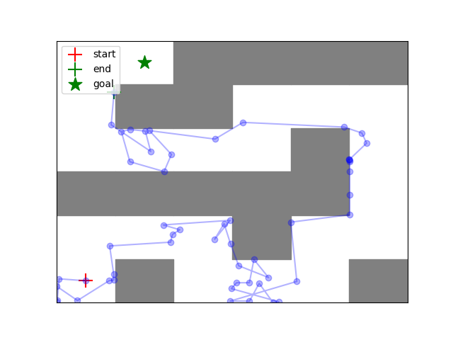
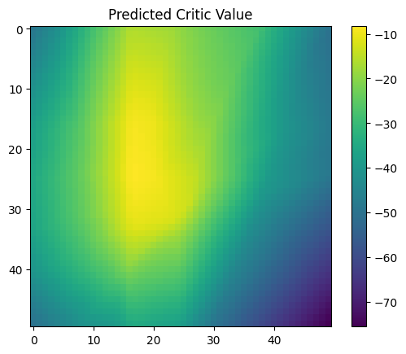
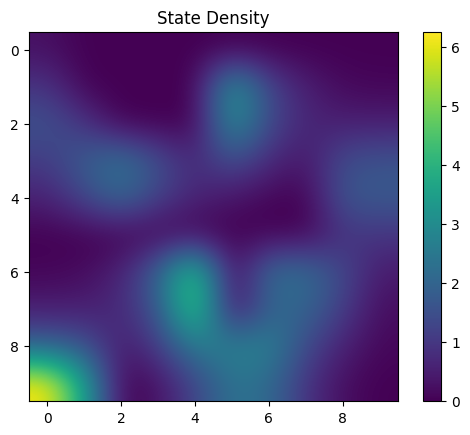
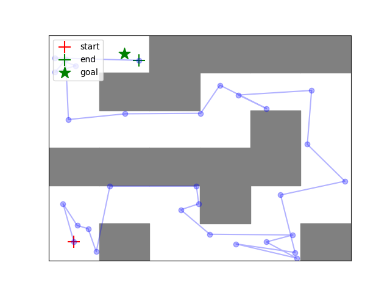
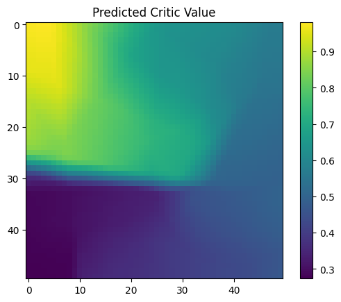
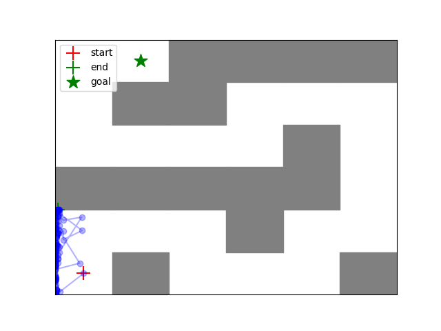
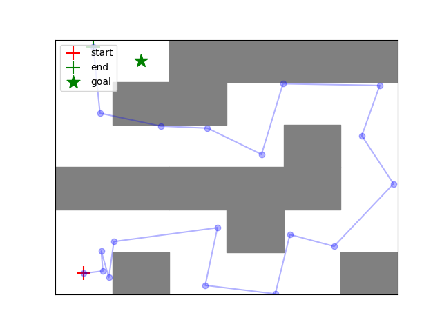

# HW5: Conservative Q-Learning (CQL) — Offline Reinforcement Learning

**Course:** CAS4160 — Reinforcement Learning (Yonsei University)  
**Environment:** PointmassMedium-v0 (2D navigation maze)

---

## Overview

This homework implements **Conservative Q-Learning (CQL)**, a key offline RL algorithm. Unlike online RL, offline RL learns from a fixed dataset without further environment interaction — which creates the problem of **Q-value overestimation** for out-of-distribution (OOD) actions.

CQL adds a conservative penalty to the standard Q-learning objective:

```
L_CQL = L_DQN + α · (E[log Σ_a exp Q(s,a)] - E[Q(s,a_dataset)])
```

- The first term pushes down Q-values for all actions (especially OOD ones)
- The second term pushes up Q-values for actions actually in the dataset
- `α` controls the strength of this regularization (α=0 reduces to standard DQN)

---

## Experiments

Two offline datasets are compared across two α values:

| | α = 0.0 (no regularization) | α = 0.1 (conservative) |
|---|---|---|
| **Expert data** | Standard DQN on expert demos | CQL on expert demos |
| **Random data** | Standard DQN on random data | CQL on random data |

---

## Results

### Expert Dataset

With α = 0.1, CQL on expert data successfully navigates the maze:

**Eval trajectory** (α=0.1, expert):



**Critic value heatmap** (α=0.1, expert):



**State density** (α=0.1, expert):



---

### Random Dataset

With random data, the dataset lacks goal-directed trajectories — even CQL struggles:

**Eval trajectory** (α=0.1, random):



**Critic value heatmap** (α=0.1, random):



---

### α Ablation

Without CQL penalty (α=0.0), Q-values become overestimated on OOD actions:

| α | Expert eval traj | Random eval traj |
|---|---|---|
| 0.0 |  |  |
| 0.1 |  |  |

---

## Project Structure

```
hw5/
├── cas4160/
│   ├── agents/
│   │   ├── cql_agent.py         # CQL agent
│   │   ├── offline_agent.py     # Offline data collection
│   │   └── dqn_agent.py         # Base DQN agent
│   ├── critics/
│   │   └── cql_critic.py        # CQL loss implementation
│   ├── envs/
│   │   └── pointmass/           # 2D navigation environment
│   ├── infrastructure/
│   │   └── rl_trainer.py        # Training loop + visualization
│   └── scripts/
│       └── run_cql.py           # Entry point
├── images/                      # Result plots
├── latex/                       # Report (LaTeX source)
├── requirements.txt
└── setup.py
```

---

## Setup

```bash
conda create -n cas4160 python=3.10 -y
conda activate cas4160
conda install -c conda-forge swig=4.0.2
pip install -r requirements.txt
pip install -e .
```

---

## Running Experiments

```bash
# Expert data, alpha=0.1
python cas4160/scripts/run_cql.py \
    --env_name PointmassMedium-v0 \
    --dataset_name expert \
    --cql_alpha 0.1 \
    --exp_name cql_alpha_0.1_expert

# Random data, alpha=0.0 (standard DQN)
python cas4160/scripts/run_cql.py \
    --env_name PointmassMedium-v0 \
    --dataset_name random \
    --cql_alpha 0.0 \
    --exp_name cql_alpha_0.0_random
```

### Visualize

```bash
tensorboard --logdir data
```

---

## Key Findings

- **Data quality dominates:** Expert data + any α learns a good policy. Random data fails even with CQL.
- **CQL (α>0) prevents OOD overestimation:** Without it, the agent exploits erroneously high Q-values for unseen state-action pairs.
- **α=0.1** provides sufficient regularization without being too conservative on the expert dataset.
